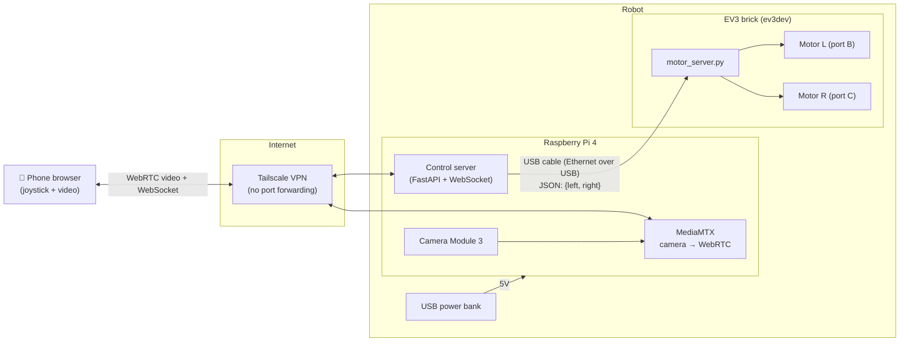

# Babloo: Pet-Monitoring Robot Design

A phone-controlled rover with a live camera for checking on pets when nobody is home.
Built on an existing LEGO EV3 brick with two drive motors, plus a Raspberry Pi for the
camera, video streaming, and the web control interface.

## 1. Goals

| Must have | Nice to have (later phases) |
|---|---|
| Live low-latency video on a phone, from anywhere (not just home Wi-Fi) | Two-way audio (hear the pet, talk to it) |
| Drive the robot from the phone with an on-screen joystick | Night vision |
| Robot stops automatically if the connection drops | Snapshots / short recordings to the phone |
| Several hours of battery life | Pet detection alerts ("dog spotted in kitchen") |
| Secure access: nobody else can see the camera | Obstacle sensing (bumper / ultrasonic) |
| Pet-safe: slow speed, nothing chewable or swallowable exposed | Treat dispenser |

## 2. Why two computers (EV3 + Raspberry Pi)

The EV3 brick is great at driving motors but far too weak for video: a 300 MHz ARM9 with
64 MB RAM and no camera interface. A Raspberry Pi is the opposite: excellent camera support
and hardware H.264 encoding, but driving the EV3 motors directly from the Pi would mean
abandoning the EV3 hardware you already have.

So the split is:

- **Raspberry Pi** = the "brain": camera, video streaming, web UI, remote access, and the
  command translator.
- **EV3 brick** = the "legs": receives simple drive commands over a cable and runs the two
  motors. Optionally reads EV3 sensors (touch bumper, ultrasonic).



## 3. Hardware components

### 3.1 Bill of materials

| # | Component | Recommendation | Approx. cost | Notes |
|---|---|---|---|---|
| 1 | LEGO EV3 brick + 2 large motors + wheels | Already owned | – | Build a simple two-wheel differential drive with a caster/skid at the back |
| 2 | Single-board computer | **Raspberry Pi 4 Model B, 1 GB or 2 GB** | $67.50 (2 GB, Oct 2026 list) | Hardware H.264 encoder, dual-band Wi-Fi, 4 USB ports. See alternatives below |
| 3 | Camera | **Raspberry Pi Camera Module 3 Wide** | $35 | 12 MP, autofocus, 120° field of view, good indoor low-light. Wide lens helps see a whole room from floor level |
| 4 | microSD for Pi | 32 GB, A1/A2 class | $10 | Raspberry Pi OS Lite 64-bit |
| 5 | microSD for EV3 | **2–32 GB SDHC** (not SDXC) | $8 | For ev3dev. EV3 cannot boot from cards larger than 32 GB |
| 6 | Pi power | USB power bank, 10 000 mAh, 5 V / 3 A output, USB-C cable | $25 | Must *not* auto-shut-off on low load. Pi 4 is sensitive to cheap cables (under-voltage throttling) |
| 7 | Pi ↔ EV3 link | USB-A to mini-USB-B cable (short, 30 cm) | $5 | EV3's "PC" port is mini-USB. Carries both the network link and nothing else; EV3 keeps its own battery |
| 8 | EV3 power | EV3 rechargeable Li-ion pack (2050 mAh) or 6× AA NiMH | owned / $60 | Rechargeable pack is strongly preferred for weight and runtime |
| 9 | Mounting | Technic-compatible Pi 4 case (several on Thingiverse / Pimoroni), or velcro straps + zip ties | $0–15 | Camera mounted 15–30 cm off the floor, tilted ~10° up |
| 10 | Cooling | Small heatsink set for Pi 4 | $5 | Fanless is fine for 720p streaming |
| | **Core total (excluding owned parts)** | | **≈ $190–210** | Pi 4 2 GB at the Oct 2026 list price of $67.50 |

Optional (later phases):

| Component | Purpose | Approx. cost |
|---|---|---|
| USB speakerphone (e.g. a small conference speaker with built-in mic) | Two-way audio in one plug-and-play device | $30–60 |
| Camera Module 3 **NoIR** + 850 nm IR LED board | Night vision in dark rooms. Needs its own 5 V from the power bank | $25 + $10 |
| EV3 Touch Sensor on a front bumper | Stop on collision | owned (in most kits) |
| EV3 Ultrasonic Sensor | Slow down near obstacles | owned (in most kits) |
| Pimoroni Pan-Tilt HAT | Look around without driving | $25 |
| Raspberry Pi AI Camera (IMX500) | On-device pet detection without loading the CPU | $70 |

### 3.2 Raspberry Pi model choice

| Model | Pros | Cons | Verdict |
|---|---|---|---|
| **Pi 4 B (2 GB)** | Hardware H.264 encode, 4× USB, dual-band Wi-Fi, headroom for audio and detection | ~4–5 W while streaming, 46 g | **Recommended** |
| Pi Zero 2 W | 15 g, ~1.5 W, $15, hardware H.264 | One micro-USB data port, 2.4 GHz Wi-Fi only, 512 MB RAM, **largely sold out as of Oct 2026** | Only if you already have one |
| Pi 5 | Fastest | **No hardware video encoder** (software encode works but burns CPU and power), needs 5 V / 5 A, runs hot | Not recommended on a battery robot |
| Pi 3 B+ | Cheap used | Slower, 2.4/5 GHz Wi-Fi ok | Fine if you already have one |

### 3.3 Power budget

| Load | Power | Energy source | Estimated runtime |
|---|---|---|---|
| Pi 4 + camera streaming 720p | ~4.5 W avg | 10 000 mAh bank (~30 Wh usable) | **≈ 6–7 h** |
| Pi Zero 2 W + camera | ~1.5 W avg | same bank | ≈ 18 h |
| EV3 brick idle + Wi-Fi off | ~1 W | 2050 mAh × 7.4 V ≈ 15 Wh | many hours |
| EV3 driving (both motors, light load) | ~5–8 W while moving | | 2–3 h of *continuous* driving; a pet-check session is mostly idle |

Keeping the Pi and EV3 on separate batteries is deliberate: the EV3's USB port cannot
reliably supply a Pi, and separate packs mean a flat Pi battery never strands the motors
mid-room (and vice versa).

### 3.4 Mechanical layout

```
            front
      ┌───────────────┐
      │  [camera]     │  ← Camera Module 3, ~20 cm high, tilted slightly up
      │  ┌─────────┐  │
      │  │  Pi 4   │  │  ← in Technic-compatible case, on top of EV3 brick
      │  └─────────┘  │
      │ ┌───────────┐ │
  ◯   │ │ EV3 brick │ │   ◯   ← large motors on ports B (left) and C (right)
      │ └───────────┘ │
      │  [power bank] │  ← low and central: keeps centre of gravity down
      └──────○────────┘
            caster / skid
```

Design rules for pets:
- **Low speed cap** in software (30–40 % of motor max ≈ 0.15–0.2 m/s).
- **Nothing chewable hanging off**: route every cable inside the frame; secure with Technic
  pins or zip ties; no loose small LEGO parts (choking hazard for dogs).
- **Wide, low base** so a curious cat can't tip it.
- **Soft front edge** (a rubber bumper or LEGO tyre segment) in case of a bump.

## 4. Software stack

### 4.1 On the Raspberry Pi

| Layer | Choice | Why |
|---|---|---|
| OS | Raspberry Pi OS Lite (64-bit) | Headless, minimal, first-party camera (libcamera / `rpicam`) support |
| Video streaming | **MediaMTX** | Single binary; reads the Pi camera natively (`rpiCamera` source), hardware-encodes H.264, and serves **WebRTC** (sub-second latency in any phone browser) plus RTSP/HLS as fallbacks. Zero custom code |
| Control server | **Python 3 + FastAPI + uvicorn** | Serves the web UI, accepts joystick input over a WebSocket, enforces the speed cap and dead-man stop, forwards drive commands to the EV3 |
| Web UI | Plain HTML/JS + **nipple.js** virtual joystick, MediaMTX WebRTC player embedded | No app to install; "Add to Home Screen" makes it feel like one. Works on iOS and Android |
| Remote access | **Tailscale** | Private mesh VPN between your phone and the Pi. No port forwarding, no public exposure, free for personal use, and WebRTC's UDP traffic passes through cleanly |
| Process management | systemd units for `mediamtx` and `babloo-control` | Everything starts on boot; robot is usable 30 s after power-on with no laptop |
| Optional: audio | `aplay` for canned clips ("good boy!") in phase 1; go2rtc or aiortc for full two-way audio in a later phase | |
| Optional: detection | `picamera2` + TensorFlow Lite (MobileNet-SSD) or Pi AI Camera; send a snapshot to the phone via `ntfy` push when a pet is seen | |

Alternatives considered: **go2rtc** (equivalent to MediaMTX, slightly better at mixing in
USB audio; pick it if two-way audio becomes a priority), **Home Assistant** (works, but a
heavyweight dependency for one robot), **MJPEG streaming** (simplest, but 5–10× the
bandwidth and noticeably more latency over the internet).

### 4.2 On the EV3

| Layer | Choice | Why |
|---|---|---|
| OS | **ev3dev** (Debian-based, boots from microSD, leaves stock firmware untouched) | Full Linux on the brick: Python 3, networking over USB, and `python-ev3dev2` for motors and sensors |
| Motor server | ~50-line Python script using `ev3dev2.motor.MoveTank` | Listens on a UDP socket for `{"left": -100..100, "right": -100..100}`, applies it to motors, and **stops the motors itself if no packet arrives for 500 ms** (second, independent dead-man switch) |
| Pi ↔ EV3 network | **Ethernet over USB** | ev3dev presents the mini-USB port as a network adapter. On the Pi, share the `usb0` interface via NetworkManager; the EV3 gets `10.42.0.x`. No Wi-Fi dongle or Bluetooth pairing needed |

Alternative: keep the **stock LEGO firmware** and drive the motors from the Pi with the
`ev3_dc` Python library (direct commands over USB). Faster to start (no SD card), but less
flexible for sensors and timing. ev3dev is recommended.

### 4.3 Control flow and safety

1. Phone sends joystick `(x, y)` over the WebSocket 20 times/second.
2. Control server on the Pi converts to tank speeds, clamps to the speed cap, and sends a
   UDP packet to the EV3.
3. If the Pi receives **no joystick message for 500 ms** (phone lost signal, app
   backgrounded, browser tab closed), it sends `stop` to the EV3.
4. If the EV3 receives **no packet for 500 ms** (USB cable unplugged, Pi crashed), it
   stops the motors on its own.
5. A big **STOP** button on the UI and a hardware option: pressing the EV3 back button
   kills the motor server.

Two independent dead-man timers mean a connection failure anywhere in the chain leaves the
robot stationary rather than driving into a wall or a sleeping dog.

### 4.4 Security

- Camera and controls are reachable **only over Tailscale**. Nothing is port-forwarded.
- MediaMTX WebRTC and the control server bind to the Tailscale interface only.
- Basic auth on the control page as a second layer (Tailscale ACLs are the first).
- Pi OS auto-updates on; SSH key-only.

## 5. Video settings

| Setting | Value | Reason |
|---|---|---|
| Resolution / frame rate | 1280×720 @ 25 fps | Enough to see a pet's expression across a room; comfortable for the hardware encoder |
| Bitrate | 1.5 Mbps | Needs ~2 Mbps of home upload bandwidth. Drop to 960×540 / 800 kbps if upload is weak |
| Latency target | < 500 ms glass-to-glass via WebRTC | Essential for driving; HLS (3–10 s) is unusable for control |
| Camera orientation | Set `hflip`/`vflip` in MediaMTX if mounted upside down | |

## 6. Repository layout (proposed)

```
Babloo/
├── docs/
│   └── DESIGN.md              ← this document
├── pi/
│   ├── control_server.py      ← FastAPI app: web UI, WebSocket, dead-man, UDP to EV3
│   ├── static/index.html      ← joystick + video page
│   ├── mediamtx.yml           ← rpiCamera source, WebRTC settings
│   ├── requirements.txt
│   └── systemd/
│       ├── babloo-control.service
│       └── mediamtx.service
├── ev3/
│   ├── motor_server.py        ← UDP listener driving MoveTank, with watchdog
│   └── babloo-motors.service
└── README.md
```

## 7. Build plan (phased)

| Phase | Goal | Steps | Done when |
|---|---|---|---|
| **0. Bench video** | Camera streaming to phone on home Wi-Fi | Flash Pi OS Lite; attach camera; install MediaMTX with `rpiCamera` source; open the WebRTC page on the phone | You see live video on the phone with < 1 s delay |
| **1. Drive** | Joystick drives the EV3 | Flash ev3dev; connect USB; share `usb0` on the Pi; write `motor_server.py`; write control server + joystick page; implement both dead-man timers | Robot drives from the phone; pulling the USB cable stops it within 0.5 s |
| **2. Remote** | Works from outside the house | Install Tailscale on Pi and phone; bind services to Tailscale IP; add systemd units; add basic auth; test on mobile data | Robot drivable with Wi-Fi turned off on the phone |
| **3. Mount & field test** | Robot survives a real session | Build the chassis; mount Pi, camera, power bank; route cables; measure runtime; tune speed cap | 2-hour unattended session with pets in the room, no faults |
| **4. Extras** | Pick from the optional list | Two-way audio → night vision → snapshots → pet detection alerts → bumper | Each feature works end to end |

## 8. Key code sketches

### EV3 motor server with watchdog (`ev3/motor_server.py`)

```python
#!/usr/bin/env python3
import json, socket, time
from ev3dev2.motor import MoveTank, OUTPUT_B, OUTPUT_C, SpeedPercent

TIMEOUT_S = 0.5
tank = MoveTank(OUTPUT_B, OUTPUT_C)
sock = socket.socket(socket.AF_INET, socket.SOCK_DGRAM)
sock.bind(("0.0.0.0", 5005))
sock.settimeout(TIMEOUT_S)

while True:
    try:
        data, _ = sock.recvfrom(256)
        cmd = json.loads(data)
        left = max(-100, min(100, cmd.get("left", 0)))
        right = max(-100, min(100, cmd.get("right", 0)))
        tank.on(SpeedPercent(left), SpeedPercent(right))
    except socket.timeout:
        tank.off()          # dead-man: no packet for 0.5 s → stop
    except Exception:
        tank.off()
```

### Joystick → tank mixing with speed cap (on the Pi)

```python
MAX_SPEED = 35  # percent; pets are slower than you think

def joystick_to_tank(x: float, y: float) -> tuple[int, int]:
    """x, y in -1..1 (right/forward positive)."""
    left = (y + x) * MAX_SPEED
    right = (y - x) * MAX_SPEED
    scale = max(1.0, abs(left) / MAX_SPEED, abs(right) / MAX_SPEED)
    return int(left / scale), int(right / scale)
```

### MediaMTX camera config (`pi/mediamtx.yml`, excerpt)

```yaml
paths:
  cam:
    source: rpiCamera
    rpiCameraWidth: 1280
    rpiCameraHeight: 720
    rpiCameraFPS: 25
    rpiCameraBitrate: 1500000
    rpiCameraAfMode: continuous
webrtcAddress: :8889
```

The phone then opens `http://<tailscale-ip>:8889/cam` for video, embedded in the control
page served by FastAPI on port 8000.

## 9. Known gotchas

- **EV3 microSD must be ≤ 32 GB (SDHC).** A 64 GB card will not boot ev3dev.
- **Pi 4 under-voltage**: use the power bank's 3 A port and a short, thick USB-C cable, or
  the Pi throttles and Wi-Fi drops.
- **Power banks that sleep**: some banks cut power when draw is low. The Pi 4 always pulls
  enough; a Pi Zero may not. Buy a bank advertising "always-on" / "low-current mode".
- **Wi-Fi dead spots**: the robot roams. If a room is weak, prefer 5 GHz near the router
  and 2.4 GHz elsewhere, or add a mesh node. WebRTC degrades gracefully; the dead-man
  timers handle full dropouts.
- **iOS Safari and WebRTC autoplay**: the video element needs `muted` + `playsinline` and
  a user tap to start. MediaMTX's built-in page already handles this.
- **EV3 auto-sleep**: ev3dev does not auto-sleep, but if you stay on stock firmware,
  disable the sleep timer in the brick settings.
- **Pets and IR**: an IR illuminator is invisible to humans but cats and dogs may notice a
  faint red glow from the LEDs. Harmless, but can draw a curious nose to the robot.
