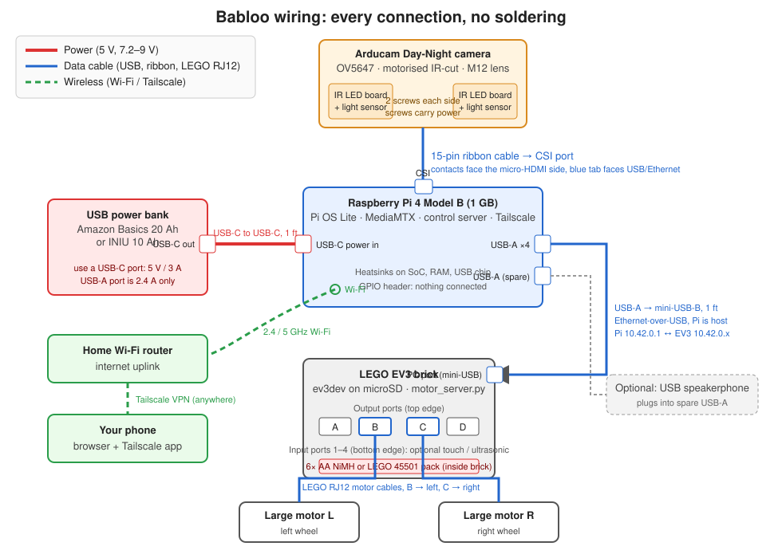

# Wiring and connections

Everything plugs together. No soldering, no GPIO wiring, no custom cables.



## The two power domains

The robot has **two separate batteries that never share power**. The only thing joining the
two sides is the USB data cable, which carries a common ground and a network link.

| Domain | Source | Powers | Why separate |
|---|---|---|---|
| 5 V | USB power bank | Raspberry Pi, camera, IR LEDs, optional speakerphone | The EV3's USB port can't supply a Pi. A flat Pi battery never strands the motors |
| 7.2–9 V | 6× AA NiMH or LEGO 45501 pack inside the brick | EV3 brick, both motors, sensors | Motors draw amps in bursts that would brown out the Pi |

Never try to power the Pi from the EV3's USB port, and never back-feed the EV3 from the Pi.

## Connection by connection

### 1. Camera → Raspberry Pi (ribbon cable)

- Cable: the 15-pin flat flexible cable that ships with the Arducam. The Pi 4 uses the 15-pin
  end on both sides.
- Pi end: the **CSI connector**, the vertical slot between the two micro-HDMI ports and the
  3.5 mm audio jack. Pull the black latch up a couple of millimetres, slide the cable in with the
  **metal contacts facing the micro-HDMI ports** and the blue stiffener facing the USB/Ethernet
  ports, then press the latch down.
- Camera end: same latch style on the back of the camera board. Contacts face the board.
- The Arducam Day-Night is not auto-detected. In `/boot/firmware/config.txt` set:
  ```
  camera_auto_detect=0
  dtoverlay=ov5647
  ```

### 2. IR LED boards → camera board (screws)

- The two LED boards mount on either side of the camera using **two screws each**, through the
  camera board's corner holes. The screws are also the electrical connection: they carry 3.3 V and
  ground from pads around the holes to the LED board.
- Tighten firmly but do not strip. A loose screw means no IR light and possibly an IR-cut filter
  that never switches.
- Each LED board has a light sensor and a small potentiometer. The sensor turns the LEDs on and
  releases the IR-cut filter when it gets dark. Turn the pot to adjust the threshold if the filter
  clicks back and forth at dusk.
- Nothing else connects to the camera. There is no separate wire for the IR-cut filter.

### 3. Power bank → Raspberry Pi (USB-C)

- Cable: USB-C to USB-C, 30 cm. The Amazon Basics bank includes one; the INIU has one built in.
- Bank end: **a USB-C output port**, which provides 5 V at 3 A. The USB-A port is limited to
  2.4 A and will produce under-voltage warnings under load.
- Pi end: the USB-C socket on the edge next to the micro-HDMI ports. This is power-only on the Pi 4.
- Strap the bank low and central on the chassis with hook-and-loop ties.

### 4. Raspberry Pi → EV3 (USB)

- Cable: USB-A (full-size) to **mini-USB-B** (the wider, trapezoid 5-pin plug; not micro-USB),
  30 cm.
- Pi end: any of the four USB-A ports. Use a USB 2.0 (black) port and leave the blue USB 3.0
  ports free; USB 3.0 ports radiate 2.4 GHz interference that can hurt Wi-Fi.
- EV3 end: the **mini-USB "PC" port** on the top edge of the brick, next to the full-size USB
  host port and the SD slot.
- What it carries: ev3dev presents the brick as a USB network adapter. The Pi shares its
  connection to it, so the brick gets an address such as `10.42.0.123` and the Pi is `10.42.0.1`.
  The motor server listens on the brick; the control server on the Pi sends it UDP packets.
- The Pi is the USB host. The cable carries no meaningful power: the EV3 is self-powered.

### 5. EV3 → motors (LEGO cables)

- Cables: standard LEGO EV3 RJ12-style cables that came with the kit. 25 cm is usually right.
- **Left large motor → output port B**, **right large motor → output port D**. Both drive motors
  are mounted facing the same way and drive the wheels directly. On this chassis a positive motor speed
  drives backwards, so both are inverted in software (`INVERT_LEFT = INVERT_RIGHT = True`), verified 2 Nov 2026.
- **Camera tilt motor → output port A**. It pivots the camera mount up and down; the motor server
  limits its travel to a soft range either side of the power-on position.
- These are the defaults in the motor server; change the constants at the top of
  `ev3/motor_server.py` if you wire them differently.
- Output ports A–D are the row on the **top** edge of the brick, next to the PC port.

### 6. Optional sensors → EV3 (LEGO cables)

- Touch sensor as a front bumper → **input port 1**.
- Ultrasonic sensor facing forward → **input port 2**.
- Input ports 1–4 are the row on the **bottom** edge of the brick.

### 7. Optional USB speakerphone → Raspberry Pi

- Plugs into a spare USB-A port on the Pi. Appears as a standard USB audio device, no drivers.
- Draws up to 0.5 A from the Pi's USB, so budget for it when choosing the power bank.

### 8. Wireless links (no cables)

- **Pi → home router:** built-in Wi-Fi, configured once in Raspberry Pi Imager before first boot.
  Prefer 5 GHz where coverage allows.
- **Phone → Pi:** Tailscale on both. On home Wi-Fi it connects directly; away from home it
  tunnels over the internet. No port forwarding on the router.

## Heatsinks

Stick the three or four heatsinks on the largest chips of the Pi 4 before it goes in the case:

- the **SoC** (big silver-topped square in the middle),
- the **RAM** chip (black rectangle beside the SoC, towards the USB-C end),
- the **USB controller** (small square near the USB-A ports).

Peel the thermal tape, press for ten seconds, done.

## Checklist before first power-on

- [ ] Camera ribbon latched at both ends, contacts the right way round
- [ ] Both IR boards screwed on, all four screws snug
- [ ] Heatsinks on, Pi in the Pi-Blox case, ribbon exits cleanly
- [ ] microSD with Pi OS in the Pi, microSD with ev3dev in the EV3, both labelled
- [ ] USB-C from the bank's **USB-C** port to the Pi
- [ ] USB-A to mini-USB from a **black** Pi port to the EV3 PC port
- [ ] Drive motors on **B** (left) and **D** (right); tilt motor on **A**
- [ ] Six charged AA cells (or the 45501 pack) in the brick
- [ ] Every cable zip-tied or velcroed so nothing dangles for a pet to chew
